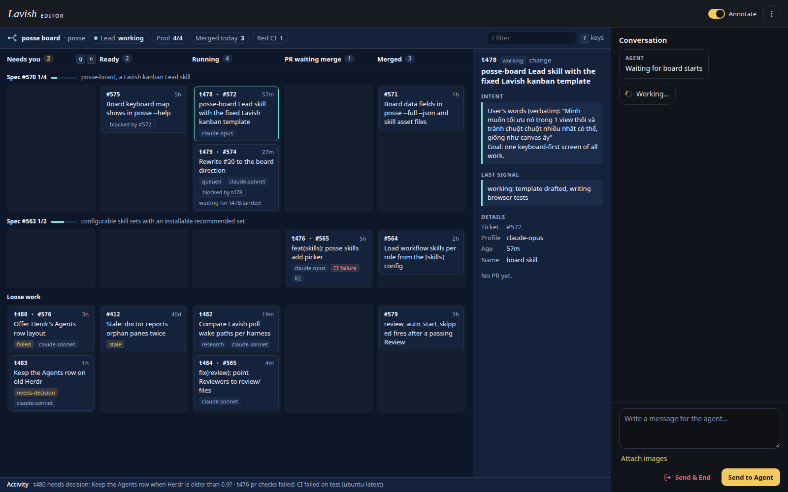

# Posse board

The `posse-board` Lead skill shows every Task and `ready-for-agent` issue of one Project on one screen, in [Lavish](https://github.com/kunchenguid/lavish-axi). You start a Ready issue from the keyboard with one confirmation, and the Lead starts the Task.

## Open the board

1. Install Lavish: `npm install -g lavish-axi`.
2. Add the skill to the Lead: `posse skills add posse-board`, or list `posse-board` under `lead` in the [`[skills]` block](skills.md).
3. In the Lead pane, say "open the board".

The Lead refreshes the data on every wake and keeps one Lavish poll running, so the board needs an awake Lead to start work. Without `lavish-axi` on PATH, the skill prints the install command and stops.

## Layout

- **Status strip:** Lead state, Pool used of `max_workers`, issues merged today, Tasks with red CI.
- **Columns:** Needs you (failed, lost, stalled, blocked and needs-decision Tasks), Ready (open issues without a Task), Running (queued, spawning and working Tasks), PR waiting merge (done and merging Change Tasks), Merged (issues closed today and finished Research Tasks).
- **Swimlanes:** one per parent spec issue, named by the `Parent spec: #N` line of each ticket, with closed and total tickets, for example `Spec #570 1/4`. Work without a spec sits in Loose work.
- **Cards:** age, Profile, CI, Review Round, merge queue place, `blocked by` chips and a `stale` flag on issues older than 21 days. Queued Tasks show their wait reason.
- **Peek panel:** the selected card's Intent block, last Signal, PR, CI, Review Round and ticket, or the issue's labels and body.
- **Activity line:** your starts and the newest open Notices.

## Keys

| Key | Action |
|---|---|
| `j` `k` | next and previous card |
| `h` `l` | previous and next column |
| `s` | start the selected Ready issue, after a confirmation |
| `enter` | open the PR, or the issue |
| `/` | filter cards; `esc` clears |
| `g` `n` | jump to Needs you |
| `?` | key help |

Dragging a Ready card onto Running asks for the same confirmation.

## Start from the board

On confirm, the board sends one `posse-board-start` prompt with the issue number to the Lead. The card shows "sent, waiting for the Lead". The Lead writes a one-ticket Brief with `review: quick`, quotes the confirmation in its `## Intent` block and starts it with `posse start --queue`. On the next refresh the card becomes the Task and the activity line shows `started tN for #N`.

## Data

The board lives in `~/.posse/projects/<project>/board/`. The skill's `refresh.sh` copies the fixed `board.html` there as `index.html` only when it changed, and writes two data files:

- `posse.js`: `posse --full --json`.
- `issues.js`: `gh issue list --label ready-for-agent --state all --limit 200 --json number,title,state,body,url,createdAt,closedAt,labels`.

Each file wraps the raw JSON in one `posseBoardData(...)` call, because Lavish serves the page in a sandboxed iframe that cannot `fetch` sibling files. The page maps the data to columns and lanes itself, so the Lead never writes HTML and the board looks the same on every load.
