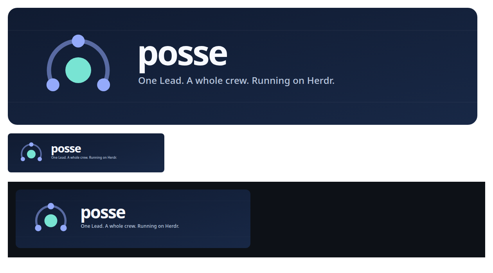
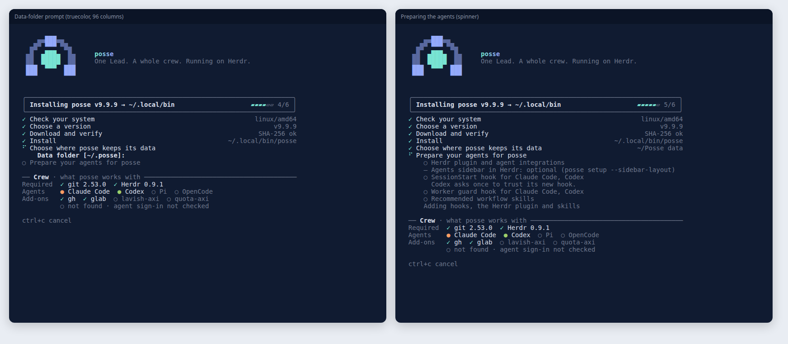
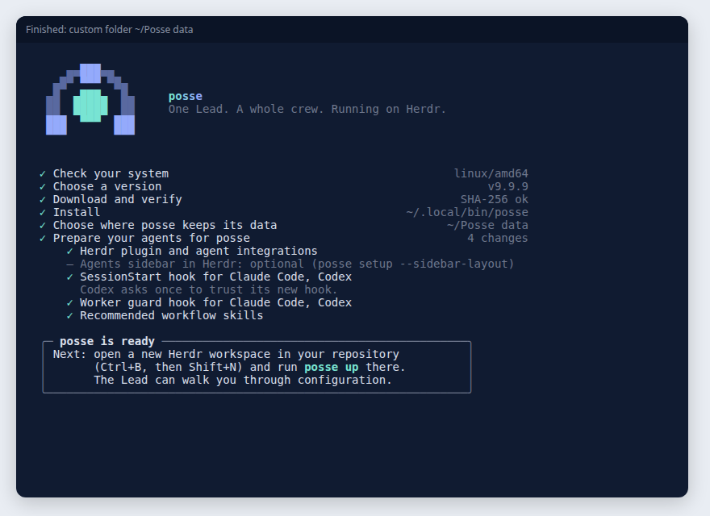
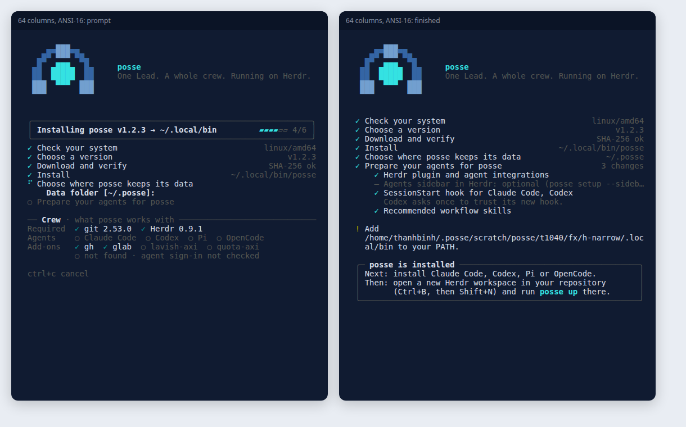
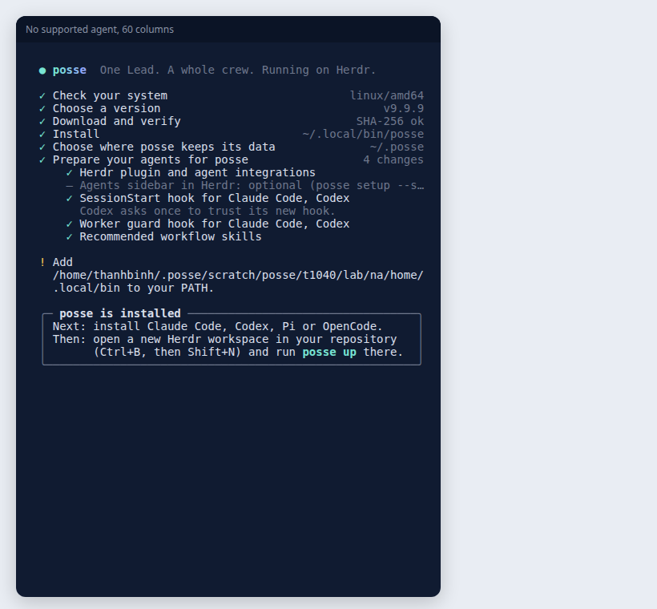
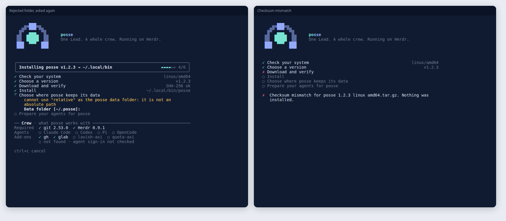
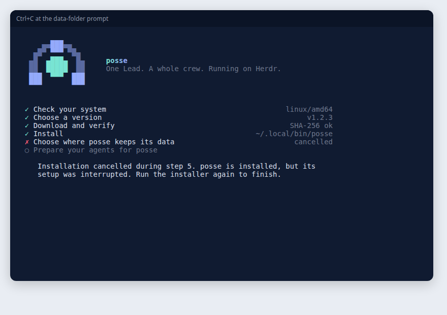

# Installer and C1 brand proof

Screens of `install.sh` recorded through a real pseudo-terminal with `script(1)` and replayed in xterm.js. The "real build" frames install a release fixture built from this branch into an isolated `HOME`, `XDG_CONFIG_HOME` and Herdr server. The other frames use the stub release fixture of `scripts/test-install.sh`.

## Banner



## Live view

The data-folder prompt, then the spinner while `posse setup` runs. Rows marked `○` are pending, `–` is optional and left alone. The Crew panel lists the agents found on `PATH` and says that agent sign-in was not checked.



Typing `~/Posse data` saved that folder in the home pointer and finished with the next step.



At 64 columns without `COLORTERM`, the same view uses ANSI-16 colors. This fixture has no agent, so the summary asks for one before `posse up`.



With no supported agent on `PATH`, the real build still prepares the machine, then reports `posse is installed` and names the missing agent. The summary box wraps to the 60-column terminal.



## Errors and cancellation

A rejected folder is explained and asked again. A checksum mismatch stops before anything is installed.



Ctrl+C at the prompt marks the step, restores the cursor and says what state the machine is in. No ticker or child process remains.



## Plain output

Without a TTY, with `NO_COLOR` or with `TERM=dumb`, the installer prints one line per event and no escape bytes. With Claude Code on `PATH`, `--yes` prepares the agents:

```text
   .--o--.
  /       \     posse
 |    @    |    One Lead. A whole crew. Running on Herdr.
  o       o

[1/6] Check your system
  ✓  System: linux / amd64
  ✓  Download tool: curl
  ✓  Archive tool: tar
  ✓  Checksum tool: sha256sum
  ✓  Git 2.53.0
  ✓  Herdr 0.9.1
  ✓  Agents found: Claude Code (sign-in not checked)
  ✓  Optional add-ons found: gh, glab
  -  Optional add-ons not found: lavish-axi, quota-axi

[2/6] Choose a version
  ✓  Using version v1.2.3
  ✓  Selected v1.2.3

[3/6] Download and verify
  -  Using the configured release base.
  ✓  SHA-256 verified for posse_1.2.3_linux_amd64.tar.gz

[4/6] Install
  ✓  Installed /home/user/.local/bin/posse

[5/6] Choose where posse keeps its data
  -  No TTY available; keeping the current data folder.
  ✓  posse keeps its data in /home/user/.posse

[6/6] Prepare your agents for posse
  ✓  Herdr plugin and agent integrations
  -  Agents sidebar in Herdr: optional (posse setup --sidebar-layout)
  ✓  SessionStart hook for Claude Code, Codex
       Codex asks once to trust its new hook.
  ✓  Recommended workflow skills

  ! Add /home/user/.local/bin to your PATH.

  +------------------------------------------------------------+
  | posse is ready                                             |
  | Next: open a new Herdr workspace in your repository        |
  |       (Ctrl+B, then Shift+N) and run posse up there.       |
  |       The Lead can walk you through configuration.         |
  +------------------------------------------------------------+
```
