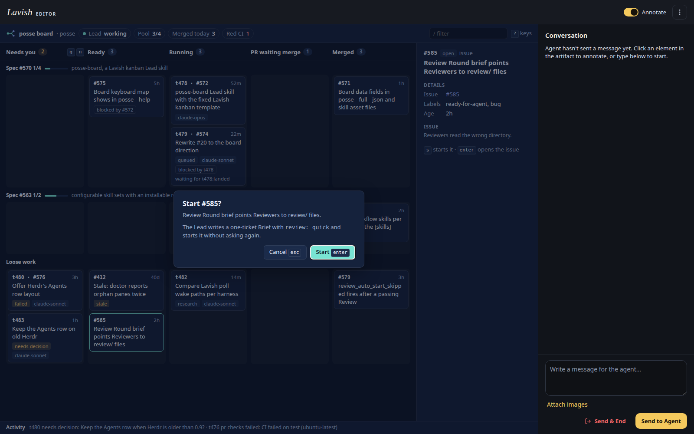
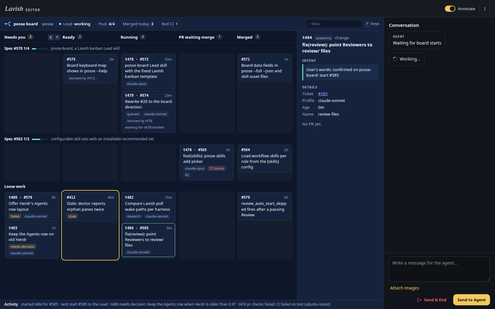
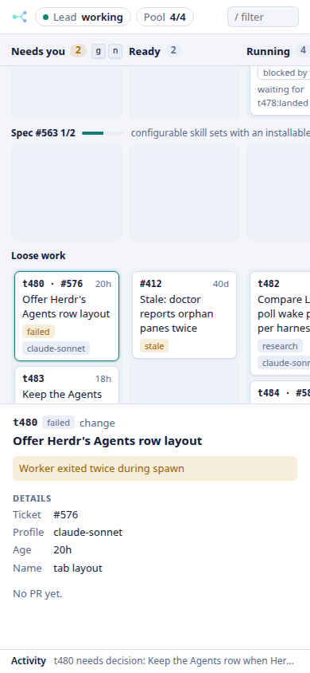

# posse-board start flow proof

The images come from a real `lavish-axi` 0.1.63 session with its state directory and port under the Task scratch directory, driven by keyboard in an isolated headless Chrome. The data files were written from fixture JSON, because a Worker may not run `posse --full --json` against the User's posse home.

Pressing `s` on the Ready issue #585 opens the confirmation:



`enter` queued one prompt, and the background `lavish-axi poll` returned it:

```text
prompts[1]{uid,prompt,selector,tag,text}:
  "1","posse-board-start #585: the User confirmed on the board to start issue #585 \"Review Round brief points Reviewers to review/ files\".\n\nContext data:\n{\n  \"action\": \"posse-board-start\",\n  \"issue\": 585,\n  ...}",button#confirm-ok,posse-board-start,Start #585
```

After `posse.js` gained Task t484 with `ticket: #585`, the next refresh replaced the issue card with the Task, kept it selected and wrote the start to the activity line:



At 390 by 844 the peek panel moves under the board and the page does not scroll:


